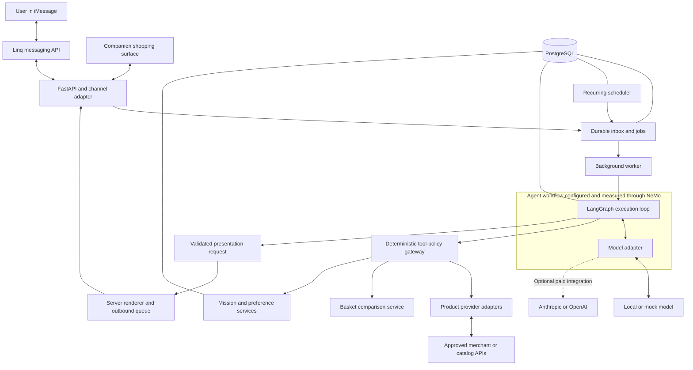

# iCart

**A conversational shopping assistant that plans complete shopping missions, starting in iMessage.**

iCart helps shoppers turn a single request or a mixed shopping list into a practical plan: what to buy, where to get it, how it fits the budget, and whether pickup or delivery meets their timing preferences.

The commerce core is designed to work across messaging channels, model providers, and product-data providers. iMessage through Linq is the first planned channel. The initial market is the United States.

> **Status: local core, PostgreSQL workflow, and experimental local model adapter implemented.** The repository contains a Python shopping CLI, fictional providers, deterministic basket comparison, scoped offer references, and a scripted model adapter. An optional PostgreSQL workflow adds saved missions/offers, duplicate-safe submission, leased jobs, retries, a transactional outbox, and a local delivery simulator. An opt-in Ollama adapter adds natural-language drafts and a native comparison tool call using a downloaded Qwen model. Live merchants, hosted LLM adapters, Linq, recurrence, LangGraph, and NeMo remain planned. No paid API calls are enabled; production availability and operating costs remain unverified.

## Run the local demo

Requires Python 3.12 or newer. From the repository root, no package installation or API keys are needed:

```sh
# Default mission: milk, eggs, and rice under $30; pickup within six hours.
PYTHONPATH=src python3 -m icart

# Compare a tighter budget and inspect machine-readable output.
PYTHONPATH=src python3 -m icart --budget 11.50 --json

# Supply an explicit list: quantities are count, millilitres, or grams.
PYTHONPATH=src python3 -m icart \
  --item milk:1000:ml --item eggs:12:count --item rice:1000:g \
  --budget 30 --fulfillment delivery --zip 60601 --within-hours 6

# Run the deterministic tests, CLI checks, and optimizer oracle.
PYTHONPATH=src python3 -m unittest discover -s tests -v
```

The default plan costs **$12.50 at one fictional store**. With an $11.50 budget, the comparator selects **$11.00 across two fictional stores**. With a $1 budget, it reports a complete over-budget basket instead of removing items.

The original interface accepts explicit flags. A separate experimental natural-language CLI is described in the [local model guide](docs/local-model.md). Fixture coverage is ZIP `60601`, with synthetic availability two hours from execution. Nothing is purchased. The original CLI is ephemeral; the optional persistent workflow saves records in PostgreSQL. No real prices, taxes, delivery slots, or checkout links are supplied.

### Persistent local workflow

Follow the [PostgreSQL setup and recovery guide](docs/persistence.md) to save a mission, process it in a separate worker, and deliver its result to a persistent local mailbox. It uses a loopback-only Docker container and optional Python dependencies. Each command exits after its work; recurrence and real messaging are not enabled.

### Shopping drafts: lifecycle and persistence

An application-level [draft lifecycle](docs/drafts.md) separates missing details, review, and confirmation. Its [PostgreSQL repository](docs/persistent-drafts.md) now saves snapshots with owner-scoped reads and atomic revision checks. Short-answer conversation handling, job submission from confirmed drafts, and integration with the natural-language CLI remain upcoming.

### What exists today

| Implemented | Planned next/later |
| --- | --- |
| Modular `src` layout and dependency-direction tests | Production authentication and runtime role separation |
| PostgreSQL mission/offer storage and leased jobs | Multi-category rules, preferences, and recurrence |
| Atomic event deduplication and local outbox delivery | External delivery reconciliation and webhook ingress |
| Immutable domain values and integer-cent arithmetic | Richer product matching and substitution workflows |
| Provider/repository ports and opt-in Ollama model adapter | Anthropic and OpenAI adapters |
| Bounded parallel fixture reads | Network adapter deadlines and recovery |
| Scoped IDs, ownership checks, tool allowlist | HTTP authentication, webhooks, and outbound delivery |
| Validated text/JSON presentation | Companion UI and channel-specific rich cards |
| Deterministic tests and opt-in synthetic model evals | LangGraph, NeMo instrumentation, and held-out model evaluations |

Read the [component walkthrough](docs/architecture.md), [persistence guide](docs/persistence.md), [interview explanation](docs/interview-guide.md), [validation guide](docs/evaluation.md), and [contribution rules](CONTRIBUTING.md). The remaining sections describe the product direction and target architecture; they are not claims that all capabilities already exist.

## The shopping experience

Example request:

> “Get milk, eggs, rice, and chicken under $60 for pickup tonight, preferably Walmart. Also find a jacket that can arrive by Friday.”

iCart treats this as one **shopping mission**, with separate fulfillment groups when necessary. It gathers material missing details, searches supported providers, compares candidate baskets, and returns one consolidated recommendation with merchant checkout links.

The intended experience supports:

- Single items, grocery lists, and mixed-category requests.
- Budget caps, quantities, package sizes, location, brands, and explicit product requirements.
- Pickup and delivery, deadlines, travel-time considerations, and future shopping dates.
- Convenience-first recommendations, favoring fewer stores when requirements are satisfied.
- Cheaper or faster alternatives when they offer a useful tradeoff.
- Proposed substitutions that remain separate until the user accepts them.
- Recurring missions with a fresh recommendation at each requested occurrence, plus pause, skip, edit, and cancel controls.
- A playful personal-shopper voice with precise prices, fulfillment details, and uncertainty reporting.

Category preferences guide discovery rather than hard-code merchant exclusivity. Walmart may be a starting preference for groceries and Amazon for general merchandise, subject to user preferences, actual coverage, and integration access.

### Coverage and checkout boundaries

The first release accepts broad discovery requests but optimizes only offers supported by verified data. Missing items, unknown fees, unconfirmed arrival times, and partial baskets must remain visible. Recommendations describe the best plan among the offers checked, not a guaranteed global minimum.

Users complete purchases with merchants. The first release does not charge cards, place orders, promise reserved inventory, or automatically purchase recurring lists. A checkout-link click is not proof of a completed order.

### Memory is explicit

“Remember that I prefer oat milk” may create a durable preference. An ordinary mention remains within the current mission. Creating a recurring list explicitly authorizes storage of the details needed to run it; a one-time substitution must not silently change that recurring list.

Conversation persistence and operational records are distinct from personalization. Retention, deletion, and sensitive-data handling must be defined before a public pilot. Users need controls to inspect, correct, and delete saved preferences.

## Architecture

One agent owns the conversation. Independent read operations can execute concurrently; conflicting changes to a mission are serialized. Narrow reader-model calls are optional isolation boundaries for unstructured external content, not a team of autonomous shopping agents.



### Components and relationships

| Component | Role | Proposed technology or ownership |
| --- | --- | --- |
| Messaging provider | Receives and delivers messages; does not make shopping decisions. | Linq for iMessage |
| Channel adapter | Translates provider events into internal messages and renders channel-appropriate responses. | iCart-owned Python code |
| API service | Verifies incoming requests, persists events, and serves application endpoints. | FastAPI |
| Orchestrator | Coordinates model calls, tool results, questions, and saved execution state. | LangGraph |
| Model adapter | Normalizes messages, tool calls, errors, usage, and supported capabilities. | iCart-owned boundary for local models, Anthropic, and OpenAI |
| Workflow instrumentation | Configures and measures the agent workflow. | NVIDIA NeMo Agent Toolkit |
| Tool-policy gateway | Enforces ownership, permitted operations, work limits, and validation before execution. | iCart-owned deterministic code |
| Product adapter | Converts a provider's catalog and fulfillment data into comparable offers with provenance. | iCart-owned integrations |
| Basket service | Computes package counts, totals, coverage, and candidate-plan tradeoffs. | Deterministic Python service |
| State and job storage | Persists missions, explicit preferences, schedules, checkpoints, and delivery records. | PostgreSQL |
| Worker and scheduler | Execute saved jobs and generate due mission occurrences. | Python processes using PostgreSQL-backed jobs |
| Renderer | Resolves verified records into messages, cards, and the companion surface. | iCart-owned presentation code |

An **adapter** translates between systems. A **provider** supplies an external capability. The **orchestrator** coordinates execution. These responsibilities remain separate so a provider change does not rewrite the shopping domain.

### What NeMo owns

Use NeMo Agent Toolkit's `langgraph_wrapper` integration, profiling, evaluation tooling, and telemetry integrations around the LangGraph workflow. LangGraph owns the agent execution flow; iCart owns authorization, shopping rules, job delivery, and domain records.

Do not add a competing NeMo prebuilt agent loop around the existing loop. NeMo Agent Toolkit does not require this project to train a model or use NVIDIA-hosted inference. NeMo Guardrails is a separate optional product, not the authorization layer.

NeMo documents OpenAI and other provider integrations, including LiteLLM. A direct Anthropic provider should not be assumed from that list: the proposed Anthropic path is through the wrapped workflow and our model adapter, subject to integration tests.

### Model independence and dual-LLM isolation

Support a common model interface while retaining capability checks. Tool calling, structured outputs, streaming, and context limits differ across models; unsupported features must fail clearly rather than silently degrade safety.

- **Mock adapter:** scripted outputs for reproducible integration and policy tests.
- **Local adapter:** behavioral experiments without hosted API charges; model selection follows hardware and tool-calling benchmarks.
- **Anthropic adapter:** optional hosted integration, disabled by default.
- **OpenAI adapter:** optional hosted integration, disabled by default.

Model-provider diversity is different from security isolation. An optional isolated reader may extract facts from unstructured listings or reviews without user-database access, credentials, action tools, or general network tools. Its structured output remains untrusted. The primary model coordinates the mission; backend policy controls execution. Either role can use any compatible adapter.

Structured provider data should use deterministic parsing where possible. Two hosted models must not run on every request by default, and no local failure may silently trigger a paid fallback.

### Core domain records

| Record | Meaning |
| --- | --- |
| User and channel binding | Internal identity associated with a verified channel context; never supplied by the model as an authority claim. |
| Mission | Items, constraints, deadlines, preferences, and current plan state. |
| Offer | A specific merchant/product variant, package, price, location, fulfillment context, source, and observation time. |
| Shopping plan | Candidate baskets, totals, missing items, substitutions, and fulfillment tradeoffs. |
| Presentation | The actual displayed records and order, so “the second one” resolves consistently. |
| Preference | A fact explicitly authorized for persistence with its originating user event. |
| Schedule and occurrence | A recurring definition and each individual execution of it. |
| Job and outbox event | Durable work and outbound delivery intent with retry and deduplication metadata. |

Mission records are authoritative business state. Graph checkpoints capture execution progress and reference those records; they must not become a conflicting second source of truth.

## A mission from message to recommendation

1. Verify the Linq webhook against its raw body, reject invalid events, and persist a deduplicated event before acknowledging it.
2. Resolve the internal user and conversation, then create a durable job.
3. Load the mission and only relevant, explicitly saved preferences. Ask for missing details that materially affect the result.
4. Use bounded parallel reads to search independent items/providers; batch requests when the provider supports it.
5. Normalize offers, retain provenance and freshness, and register server-issued references for the mission.
6. Compute feasible baskets in code. Enforce explicit requirements first, then prefer convenience and compare known costs and timing.
7. Have the model propose a presentation using authorized record references. Resolve prices, products, and checkout destinations in the backend.
8. Persist the outbound message, render it for the channel, and reconcile delivery events.
9. For recurring missions, create a fresh occurrence at the requested time and recheck that the schedule is still active before sending.

No feasible plan means an explicit explanation of the shortfall. Unknown fees are not zero; unavailable items are not silently omitted; deadlines are not confirmed without supporting data.

## Security and abuse prevention

**Security objective:** a model that follows an injected instruction must still be unable to exercise unauthorized capabilities. Prompt instructions and model-based checks are supporting layers, not permission enforcement.

### Server-issued references

Tools and presentation requests operate on references issued by the backend for the current user and mission. The backend checks ownership, allowed operation, and offer validity before resolving the record. An invented reference, a reference planted in a review, or another user's reference is rejected.

References are not authorization by themselves. A user-supplied product URL must first pass an approved lookup and validation flow. The model cannot choose arbitrary commerce prices, recipients, or checkout URLs.

### Threats and controls

| Threat | Planned controls |
| --- | --- |
| Indirect prompt injection | Constrain untrusted content, preserve provenance, optionally isolate extraction, and enforce permissions outside the model. |
| Data exfiltration | Minimize model-visible private data; bind message destinations to application context; restrict provider operations and outbound network destinations. |
| Cross-user access | Enforce user/tenant ownership on every operation, with identity derived from authenticated context. |
| Memory poisoning | Require explicit user authorization and source events; reject provider-authored attempts to create preferences. |
| Tool poisoning or changed tool behavior | Application-controlled registry, reviewed definitions, version pinning, manifest-change detection, and least-privilege credentials. |
| False read-only annotations | Treat MCP `readOnlyHint` and other annotations as hints, never self-granted permissions. |
| Malicious URLs and server-side request forgery | Allow approved destinations, validate redirects and resolved addresses, and block private-network/metadata destinations for external fetches. |
| Forged or replayed events | Signature verification, timestamp checks, persistent event deduplication, and unique operation keys. |
| Concurrent limit bypass | Validate resulting state in transactions and serialize conflicting mission changes. |
| Resource exhaustion | Bound list size, payload size, tool calls, retries, concurrency, execution time, and active schedules. |
| Unsafe rendered content | Escape external text, sanitize markup, and build commerce cards from validated records. |
| Stale recurring actions | Version schedules and recheck pause/edit/cancel state before executing and sending. |

Authentication, authorization, and merchant trust remain separate. A valid Linq signature identifies the delivery source, not the real-world identity of the phone holder. An approved marketplace does not establish the authenticity of every seller or listing.

### Provenance and capability controls

Use a bounded design inspired by capability security and CaMeL research: record where data originated and enforce which operations it may influence. Product descriptions may inform comparisons but may not set recipients, grant permissions, or authorize memory writes. Reader-model output cannot mint valid offer references.

This is not a claim to implement CaMeL's full interpreter or its research guarantees. Labels alone do not enforce information flow, and dual-LLM isolation does not solve prompt injection.

### Fraud boundary

The initial system addresses account abuse, phishing destinations, unauthorized data access, and resource abuse. Private companion pages need expiring access; channel accounts must not be linked through model inference alone. Suspicious actions can be rejected or the affected capability suspended.

Payment fraud detection is outside the initial merchant-checkout scope. A later purchase feature requires exact-order approval, expiry, revalidation at execution, payment-provider controls, idempotent transaction handling, and reconciliation. It must not reuse an old approval for a changed order.

## Reliability, latency, and observability

- Persist inbound events and outbound intentions; use recoverable jobs instead of fire-and-forget in-process tasks.
- Design for at-least-once work delivery. Deduplication and reconciliation reduce duplicates; do not claim exactly-once delivery across external APIs.
- Keep provider timeouts and failures isolated, and report partial coverage accurately.
- Bound parallel reads; serialize writes that affect the same state.
- Keep common model instructions stable, limit irrelevant context, and use provider caching only where supported and permitted.
- Record end-to-end traces with model/prompt/tool versions, operation outcomes, latency, and usage. Redact secrets and personal data.
- Measure time to first useful response, complete-plan latency, provider failure rates, and cost per completed mission.
- Treat local load-test results as local measurements, not proof of production capacity.

## Evaluation strategy

### Three complementary layers

| Layer | Purpose | Initial execution |
| --- | --- | --- |
| Deterministic tests | Prove ownership checks, reference validation, basket arithmetic, and schedule rules. | Local, mocked dependencies |
| Model behavior evaluations | Measure useful shopping behavior, grounding, and resistance to injected content. | Local compatible model |
| Reliability and load tests | Exercise retries, restarts, concurrent edits, queues, and delivery reconciliation. | Local synthetic workloads |

Use saved mission snapshots with expected outcomes, including long or contradictory histories. Grade resulting state and rendered facts rather than requiring one exact tool-call sequence.

The initial suite covers clean and attacked versions of shopping requests, mixed lists, package quantities, budget failures, unknown fees, rejected substitutions, cross-user references, memory poisoning, malicious URLs, malformed tool calls, duplicate webhooks, stale schedules, provider failures, and displayed-item references.

Report legitimate task completion, attack success, unauthorized executed actions, false refusals, grounding, constraint satisfaction, latency, and resource usage. Zero observed failures applies only to the tested cases and configurations.

Adapt relevant AgentDojo attack patterns into a separately labeled commerce suite. Do not present adapted cases as an official benchmark score. Keep held-out cases for comparing a basic baseline, reference enforcement, provenance controls, and reader isolation. Weakened baselines run only against isolated synthetic data.

### Release discipline

Deterministic security invariants block releases when they fail. Run core safety and affected behavior cases on changes, with broader model evaluations before releases when a model runtime is available. Version datasets, prompts, models, tools, and configurations together in evaluation reports.

A public deployment additionally needs measured quality/latency thresholds, canary rollout, capability kill switches, monitored queues, backups, restore drills, and incident procedures. No compliance certification or enterprise-scale validation is claimed.

## Local-first development and cost

The initial target is **no incremental paid service spending**: local backend, PostgreSQL, worker, scheduler, mock providers, synthetic catalogs, and local evaluation artifacts. Local model inference uses existing hardware and still consumes compute and electricity.

Hosted model adapters are disabled by default. Paid fallback and paid evaluation judges are disabled. Live cloud behavior cannot be validated by mock tests and will be labeled unverified until explicitly enabled and tested.

Linq's sandbox is temporary; production messaging pricing and product-data access must be verified before promising an always-on pilot. Local schedules execute only while the machine and processes are running. Always-on hosting is a later deployment decision.

Use the source-execution commands above for the in-memory demo. The package metadata also defines an `icart` entrypoint, but source execution avoids build-tool downloads. The optional PostgreSQL workflow uses `requirements-postgres.txt`, `compose.yaml`, and the development-only connection settings documented in `.env.example`. The CLI reads process environment variables; it does not automatically load `.env` files.

## Implementation roadmap

- [x] Define initial mission, offer, product-provider, repository, and scripted-model contracts.
- [x] Build an explicit local CLI, synthetic catalog adapters, and deterministic basket comparison.
- [x] Add mission ownership, server-issued references, a comparison-tool allowlist, and validated presentation.
- [x] Add deterministic tests, an independent optimizer oracle, and dependency-boundary checks.
- [ ] Add internal channel-event contracts and richer conversational presentation.
- [x] Add PostgreSQL mission/offer persistence, duplicate-safe submissions, and leased jobs.
- [x] Add bounded retries, atomic completion/outbox writes, and a persistent local mailbox.
- [ ] Add recurring schedule occurrences and external messaging delivery/reconciliation.
- [ ] Extend policy enforcement to authenticated channels, durable writes, schedules, and network egress.
- [x] Add an opt-in local model adapter, validated intent drafts, and a synthetic evaluation runner.
- [ ] Connect a single LangGraph agent loop using the existing model contracts.
- [ ] Integrate NeMo profiling, traces, and repeatable evaluations.
- [ ] Add optional isolated extraction and measure its security/latency tradeoffs.
- [ ] Build playful channel-appropriate presentations and explicit preference controls.
- [ ] Validate Linq sandbox behavior, including duplicate events and delivery failures.
- [ ] Add Anthropic/OpenAI adapter contract tests; defer billable live tests until enabled.
- [ ] Obtain and validate real product-data coverage and merchant handoff behavior.
- [ ] Publish measured evaluation reports and a reproducible attack-and-recovery demo.
- [ ] Define public-pilot budget, retention, authentication, service targets, and operational readiness.

## References

- [Anthropic: The anatomy of effective commerce agents](https://claude.com/blog/the-anatomy-of-effective-commerce-agents)
- [NVIDIA NeMo Agent Toolkit overview](https://docs.nvidia.com/nemo/agent-toolkit/latest/index.html)
- [NeMo: Wrapping existing LangGraph agents](https://docs.nvidia.com/nemo/agent-toolkit/latest/run-workflows/existing-agents/langgraph.html)
- [NeMo: Model providers](https://docs.nvidia.com/nemo/agent-toolkit/latest/build-workflows/llms/index.html)
- [LangGraph persistence](https://docs.langchain.com/oss/python/langgraph/persistence)
- [Anthropic tool use](https://platform.claude.com/docs/en/agents-and-tools/tool-use/overview)
- [OpenAI function calling](https://developers.openai.com/api/docs/guides/function-calling)
- [Linq API documentation](https://docs.linqapp.com/channel/imessage/api/)
- [Linq pricing and sandbox](https://linqapp.com/s/pricing)
- [MCP tool annotations](https://modelcontextprotocol.io/specification/2025-11-25/schema#toolannotations)
- [CaMeL: Defeating Prompt Injections by Design](https://arxiv.org/abs/2503.18813)
- [AgentDojo benchmark and evaluation environment](https://github.com/ethz-spylab/agentdojo)

This is an independent project. Mentioned providers and research projects are integration candidates or references, not endorsements or affiliations.

## License

[MIT](LICENSE).
