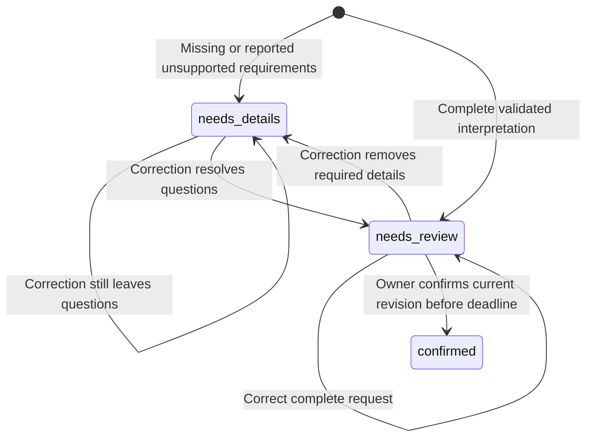

# Step 1: shopping draft lifecycle

A complete model interpretation is a proposal. It is not evidence that the shopper has reviewed or approved it. This module makes that distinction explicit before we add persistent conversations.



`confirmed` means approved for planning. It does not mean a job was submitted, a message was sent, or a purchase was authorized. The later database transaction will own submission. Confirmed drafts are closed in this first version; changing one requires a new draft.

## Follow the code

1. `start_draft` calls the existing interpretation validator and creates revision 1. Identity comes from application context. A complete request enters `needs_review`; questions produce `needs_details`.
2. `revise_draft` checks the owner and expected revision before calling the model. It revalidates a full corrected request and returns a new snapshot with an incremented revision. It currently does not parse or merge a short answer such as `$20`.
3. `confirm_draft` accepts explicit approval from the future trusted interface. It checks ownership, revision, unresolved questions, and deadline. It performs no model call and is not a model tool.

The immutable snapshot contains the original text, JSON intent, questions, and an optional normalized mission. JSON is stored as a string so a mutable dictionary returned by a model cannot alter the snapshot later. The dataclass is an internal application value, not an authenticated deserialization boundary; future database and channel adapters must validate reconstructed records and supplied identities.

## Why revisions matter

Suppose a shopper reviews revision 2 with a $20 budget. An edit creates revision 3 with a $30 budget. An approval carrying `expected_revision=2` must not approve revision 3. The application raises `RevisionConflict` instead.

These functions only compare against the snapshot they receive. Two processes holding the same old snapshot could both compute updates. **The pure functions alone provide no concurrent-write guarantee.** The new [PostgreSQL draft repository](persistent-drafts.md) now locks and validates the current revision before saving, rejecting the losing update. Atomic job creation from a confirmed draft remains future work.

Corrections retain the original time anchor. Editing the budget must not move “within six hours” six hours into the future again. Explicit deadline rescheduling will require a separate policy; it is not implemented here. Confirmation rejects an expired deadline.

## Try the first step

From the repository root:

```sh
PYTHONPATH=src python3 examples/draft_lifecycle.py
PYTHONPATH=src python3 -m unittest discover -s tests -p test_drafts.py -v
```

The example prints `needs_details → needs_review → confirmed`, using scripted extraction and a full corrected request. It performs no model inference, database writes, job submission, or purchases.

The tests exercise the useful path plus stale approvals, cross-user access, missing details, reported unsupported restrictions, closed drafts, expired deadlines, and mutation of a model-owned dictionary.

## What comes next

Draft snapshots and atomic revision checks are now implemented in [the persistence step](persistent-drafts.md). Next, add conversation identity and short-answer handling. Connect confirmed requests to the existing job/outbox workflow only after transaction and retry behavior is tested. Model jobs also require lease renewal and bounded execution.

The existing natural-language CLI is unchanged and does not yet use this lifecycle. No new protection is claimed for that CLI until the integration is implemented. This first step is deliberately a separately testable application module.
